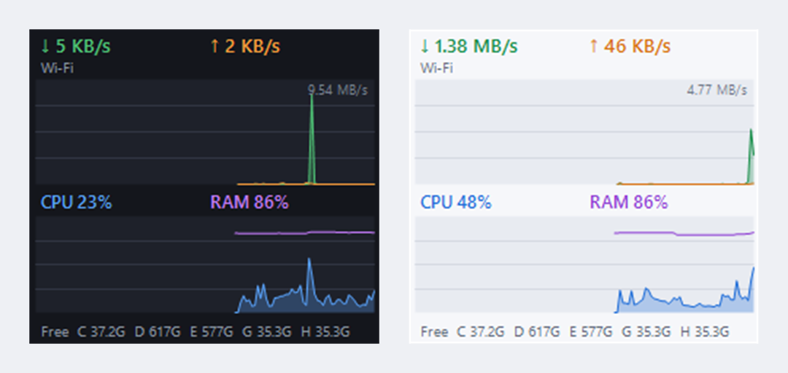
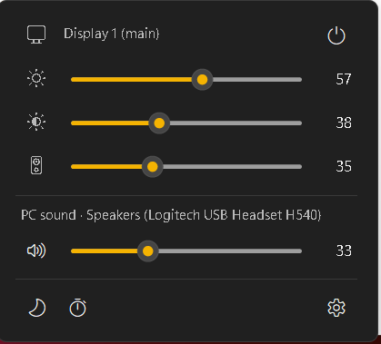

<p align="center">
  
</p>

<h1 align="center">TrayPal</h1>

<p align="center">
  A tiny always-on-top companion for your Windows desktop.<br>
  Network speed, CPU, RAM, disk, battery, screen brightness and dark mode, one click away.
</p>

<p align="center">
  
</p>

## What it does

- **Network speed:** live download and upload with a two-minute graph
- **CPU and RAM:** optional graph underneath
- **Disk and battery:** optional one-line readout of free space, plus battery percent on laptops
- **Quick panel:** click the tray icon for brightness, contrast and the monitor's own speaker volume (external monitors, via DDC/CI), plus your PC's sound with mute, a "screens off" button, and a soft ding so you hear the new volume
- **Focus timer:** 25-minute focus and 5-minute break blocks, with a small window to add time, pause, mute the ring or stop
- **Windows dark/light mode:** one click from the quick panel or the right-click menu
- **Settings window:** dark, light or match-Windows theme, opacity, size, click-through, start with Windows and timer lengths
- Sharp on high-DPI screens (125%, 150% and up)

<p align="center">
  
</p>

## Install

Download **TrayPal-Setup.exe** from [Releases](../../releases). It installs for your user only, no admin prompt. Prefer portable? Grab `TrayPal.exe` and run it from anywhere.

> Windows SmartScreen may say "unknown publisher" because the app isn't code-signed. Click **More info, then Run anyway**.

## Use

- **Move:** drag it. It remembers where you left it.
- **Quick panel:** left-click the tray icon. The gear opens Settings.
- **Settings and focus timer:** right-click the window or the tray icon.
- **Show or hide the meter:** double-click the tray icon. It also brings back a click-through meter.

## Good to know

- Light on resources: about 2 to 3 ms of CPU per second and roughly 40 MB of memory with the CPU + RAM graph on.
- No telemetry and no network access of its own. It reads Windows' own counters and talks to your monitor over DDC/CI.
- Network figures are for this PC only, not your whole home network.
- Brightness, contrast and monitor volume need a monitor that supports DDC/CI; a slider only shows if your monitor reports it. Laptop built-in screens are not supported.

## Build

Needs nothing except Windows. The C# compiler ships with .NET Framework 4.x.

```
build.cmd
```

Produces `dist\TrayPal.exe`, and `dist\TrayPal-Setup.exe` too if [Inno Setup 6](https://jrsoftware.org/isinfo.php) is installed. Pushing a tag like `v1.0.0` builds and publishes a release through GitHub Actions.

## Licence

MIT. Made by Ahmed, [mrobaidi.com](https://mrobaidi.com).
