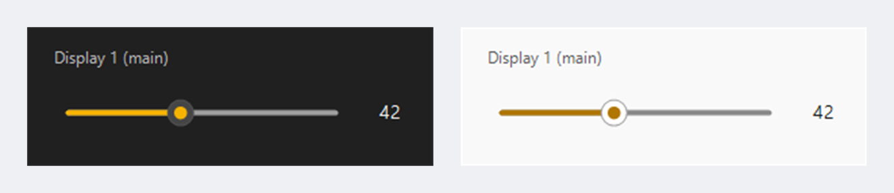

<p align="center">
  
</p>

<h1 align="center">TrayPal</h1>

<p align="center">
  A tiny always-on-top companion for your Windows desktop.<br>
  Network speed, CPU, RAM, disk, battery, screen brightness and dark mode, one click away.
</p>

<p align="center">
  
</p>

## What it does

- **Network speed:** live download and upload with a two-minute graph
- **CPU and RAM:** optional graph underneath
- **Disk and battery:** optional one-line readout of free space, plus battery percent on laptops
- **Brightness:** click the tray icon for a slider (external monitors, via DDC/CI)
- **Windows dark/light mode:** switch from the right-click menu
- Dark, light or match-Windows theme, adjustable opacity and size, click-through, and start with Windows

<p align="center">
  
</p>

## Install

Download **TrayPal-Setup.exe** from [Releases](../../releases). It installs for your user only, no admin prompt. Prefer portable? Grab `TrayPal.exe` and run it from anywhere.

> Windows SmartScreen may say "unknown publisher" because the app isn't code-signed. Click **More info, then Run anyway**.

## Use

- **Move:** drag it. It remembers where you left it.
- **Brightness:** left-click the tray icon, or right-click, Brightness...
- **Everything else:** right-click the window or the tray icon.
- **Hidden or click-through?** Double-click the tray icon.

## Good to know

- Light on resources: about 1 to 2 ms of CPU per second and roughly 40 MB of memory with the CPU + RAM graph on.
- No telemetry and no network access of its own. It reads Windows' own counters and talks to your monitor over DDC/CI.
- Network figures are for this PC only, not your whole home network.
- Brightness needs a monitor that supports DDC/CI. Laptop built-in screens are not supported.

## Build

Needs nothing except Windows. The C# compiler ships with .NET Framework 4.x.

```
build.cmd
```

Produces `dist\TrayPal.exe`, and `dist\TrayPal-Setup.exe` too if [Inno Setup 6](https://jrsoftware.org/isinfo.php) is installed. Pushing a tag like `v1.0.0` builds and publishes a release through GitHub Actions.

## Licence

MIT. Made by Ahmed, [mrobaidi.com](https://mrobaidi.com).
